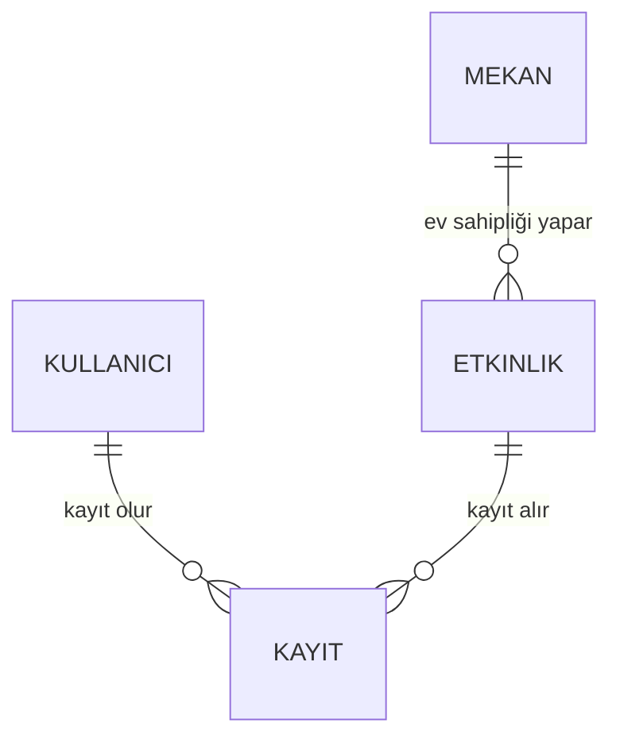

# Kampüs Etkinlik Sistemi — Veritabanı Projesi

Başkent Üniversitesi **YBS212 Veri Tabanı Yönetim Sistemleri** dersi için hazırladığım dönem projesi (Mayıs 2025). Projede takım lideriydim ve işin büyük kısmını üstlendim.

Sistem, öğrenci ve personelin kampüsteki etkinlikleri listeleyip bunlara kayıt olmasını, etkinlik yöneticisinin de etkinlikleri yönetip katılımcı raporu almasını sağlıyor.

## Proje aşamaları

1. **İhtiyaç analizi:** Fiil-isim analizi, kullanım senaryoları (use case), etkinlik ve veri akış çizenekleri
2. **Kavramsal tasarım:** Varlık-ilişki modeli
3. **Mantıksal tasarım:** İlişkisel şema ve 3NF'ye kadar normalizasyon
4. **Fiziksel tasarım:** MySQL Workbench ile modelleme, tabloların oluşturulması, veri ekleme, sorgulama, güncelleme ve silme

Analiz ve tasarım ayrıntıları: [`docs/analiz.md`](docs/analiz.md)

## Dosyalar

| Dosya | İçerik |
| --- | --- |
| `sql/01_schema.sql` | Tablolar, birincil ve yabancı anahtarlar, kısıtlar |
| `sql/02_veri_ekleme.sql` | Örnek veriler |
| `sql/03_sorgular.sql` | Tarih aralığı sorgusu, 4 tabloyu birleştiren JOIN, katılımcı raporu |
| `sql/04_guncelleme_silme.sql` | UPDATE ve DELETE örnekleri |
| `sql/05_ek_kontenjan_ve_rapor.sql` | **Sonradan eklendi:** doluluk raporu ve kontenjan trigger'ı |
| `tests/kontenjan_testi.sql` | Kontenjan kuralının testi |

## Veri modeli



Kullanıcı ile etkinlik arasındaki çoka-çok ilişki `Kayit` ara tablosuyla çözüldü. Aynı kişinin aynı etkinliğe iki kez kayıt olması benzersiz bir anahtarla engelleniyor.

## Ders sonrası eklenenler

Projenin etkinlik çizeneğinde "Mekan kapasitesi dolu mu?" kontrolü vardı, ancak ders kapsamında veritabanına uygulanmamıştı. Teslimden sonra bu kuralı bir **BEFORE INSERT trigger'ı** ile ekledim: mekan doluysa yeni kayıt `Hata: Kontenjan dolu` mesajıyla reddediliyor. Kontrol uygulamada değil veritabanında olduğu için kayıt hangi arayüzden gelirse gelsin geçerli. Ayrıca her etkinliğin doluluk oranını gösteren bir rapor sorgusu (`LEFT JOIN` + `GROUP BY`) ekledim.

## Çalıştırma

MySQL 8 (veya MariaDB 10.5+) üzerinde dosyaları sırasıyla çalıştırın:

```bash
for f in sql/0*.sql; do mysql -u root -p < "$f"; done
mysql -u root -p < tests/kontenjan_testi.sql   # son INSERT reddedilmeli
```

## Notlar

- Örnek verilerdeki kişi adları ve e-postalar kurgusaldır.
- Scriptler, proje raporundaki MySQL Workbench çıktılarından yeniden düzenlenmiştir.
