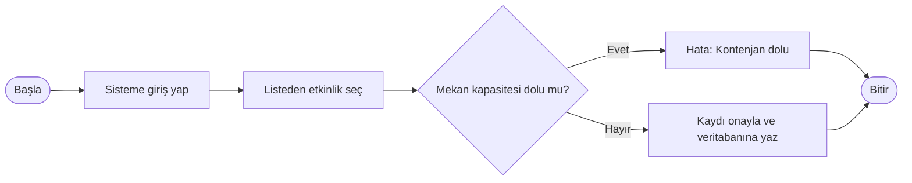
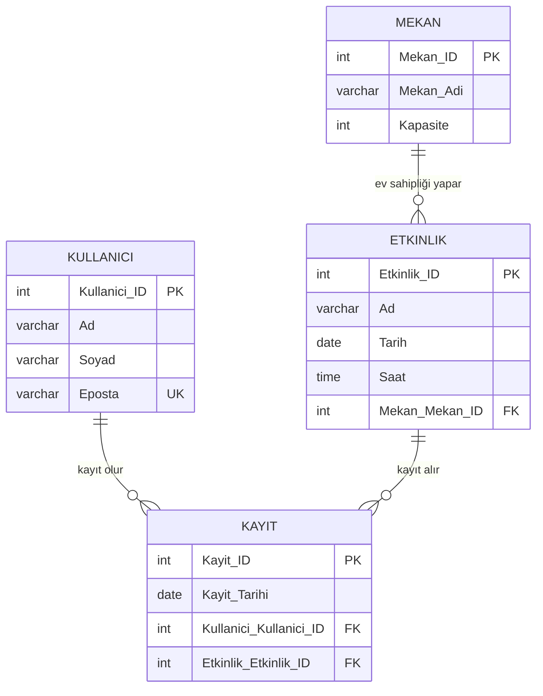

# Analiz ve Tasarım

## Aktörler ve kullanım senaryoları

**Aktörler**
- **Öğrenci / Personel:** Etkinlikleri sorgular ve etkinliklere kayıt olur.
- **Etkinlik Yöneticisi:** Etkinlik ekler, günceller, siler ve katılımcı raporu alır.

**Senaryolar**
| Kod | Senaryo | Aktör |
| --- | --- | --- |
| UC1 | Etkinlikleri tarih aralığına göre listeleme | Öğrenci / Personel |
| UC2 | Etkinliğe kayıt olma (kontenjan kontrolüyle) | Öğrenci / Personel |
| UC3 | Etkinlik ekleme, güncelleme, silme | Etkinlik Yöneticisi |
| UC4 | Bir etkinliğe kayıtlı öğrencilerin raporu | Etkinlik Yöneticisi |

## Kayıt akışı

## Varlık-ilişki modeli

Kullanıcı ile etkinlik arasında **çoka-çok** ilişki var: bir kullanıcı birden fazla etkinliğe, bir etkinliğe birden fazla kullanıcı kayıt olabilir. Bu ilişki `Kayit` ara tablosuyla iki adet bire-çok ilişkiye dönüştürüldü.

## İlişkisel şema

Altı çizili alanlar birincil anahtar, *italik* alanlar yabancı anahtardır.

- **Kullanici** (<u>Kullanici_ID</u>, Ad, Soyad, Eposta)
- **Mekan** (<u>Mekan_ID</u>, Mekan_Adi, Kapasite)
- **Etkinlik** (<u>Etkinlik_ID</u>, Ad, Tarih, Saat, *Mekan_ID*)
- **Kayit** (<u>Kayit_ID</u>, Kayit_Tarihi, *Kullanici_ID*, *Etkinlik_ID*)

## Normalizasyon

- **1NF:** Tüm alanlar atomik. Örneğin ad ve soyad ayrı kolonlarda; bir kayıt satırında yalnızca bir kullanıcı ve bir etkinlik var, tekrar eden grup yok.
- **2NF:** Kısmi bağımlılıklar kaldırıldı. Kapasite yalnızca mekana ait bir bilgi olduğu için etkinlik tablosundan ayrılıp kendi anahtarı olan `Mekan` tablosuna taşındı.
- **3NF:** Geçişli bağımlılık yok. Anahtar olmayan hiçbir alan başka bir anahtar olmayan alana bağlı değil; her alan doğrudan kendi tablosunun birincil anahtarına bağlı.
